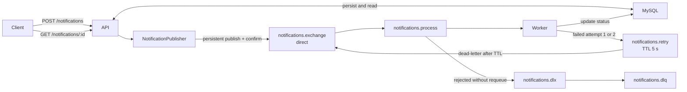

# Notification Service

A small asynchronous notification service built with NestJS. The API persists a
request and returns after RabbitMQ confirms publication; an independent worker
processes it in the background. RabbitMQ decouples HTTP request handling from
processing and holds work while the worker is offline.

The sender is deterministic and simulated. No external email service is called.

## Stack

NestJS, TypeScript, MySQL, TypeORM, RabbitMQ, Docker Compose, Jest, and
Swagger/OpenAPI.

## Architecture



```text
apps/
  api/                 HTTP API and RabbitMQ publisher
  worker/              RabbitMQ consumer and simulated sender
libs/
  notifications/       Entity, migration, message contract, and topology
docker-compose.yml     Local MySQL and RabbitMQ
```

The API and worker share the Notification entity and RabbitMQ contract. Schema
changes use TypeORM migrations; automatic synchronization is disabled.

## Run locally

Requirements: Node.js 20 or newer, npm, and Docker with Compose. Ports 3000,
3307, 5672, and 15672 must be available.

1. Install dependencies: `npm ci --no-audit --no-fund`.
2. Copy `.env.example` to `.env` and review the local settings. On PowerShell,
   use `Copy-Item .env.example .env`.
3. Start infrastructure: `docker compose up -d --wait mysql rabbitmq`.
4. Apply the schema: `npm run migration:run`.
5. Start the API: `npm run start:dev:api`.
6. In another terminal, start the worker: `npm run start:dev:worker`.

API: `http://localhost:3000` · Swagger UI: `http://localhost:3000/docs` ·
OpenAPI JSON: `http://localhost:3000/docs-json` · RabbitMQ Management UI:
`http://localhost:15672` (local credentials from `.env.example`). Docker
Compose runs only MySQL and RabbitMQ; API and worker run as separate NestJS apps.

## Use the API

```bash
curl -i -X POST http://localhost:3000/notifications -H 'Content-Type: application/json' -d '{"recipient":"user@example.com","type":"EMAIL","subject":"Welcome","message":"Welcome to the platform"}'
```

The API saves a `PENDING` row, publishes a persistent message, waits for a
publisher confirm, and then returns HTTP 202:

```json
{"id":"6cdb2202-054d-4420-8058-eacc8ecdde25","status":"PENDING"}
```

Use the returned ID to read the current state from MySQL:

```bash
curl -i http://localhost:3000/notifications/6cdb2202-054d-4420-8058-eacc8ecdde25
```

After processing, a response can look like:

```json
{"id":"6cdb2202-054d-4420-8058-eacc8ecdde25","type":"EMAIL","recipient":"user@example.com","status":"SENT","createdAt":"2026-10-03T12:00:00.000Z","processedAt":"2026-10-03T12:00:05.000Z"}
```

`GET /notifications/:id` returns HTTP 200 and only `id`, `type`, `recipient`,
`status`, `createdAt`, and `processedAt`. Timestamps are ISO-8601 UTC;
`processedAt` is null until processing reaches a terminal state. A malformed
UUID returns 400 and an unknown valid UUID returns 404. There is no list route.

## Processing and failures

Success: `PENDING → PROCESSING → simulated send → SENT + processedAt → ack`.
The API does not wait for the worker. A client may observe `PENDING` or
`PROCESSING` before `SENT`.
With repeated sender failures: `PENDING → PROCESSING → retry → FAILED`.

The worker uses manual acknowledgement and prefetch 1. New messages carry
`x-attempt: 1`; an absent header is treated as attempt 1. A sender failure on
attempt 1 or 2 saves `PENDING` with `processedAt = null`, publishes the same
payload and `messageId` to `notifications.retry`, waits for publisher confirm,
and only then acks the original. The retry queue has a fixed 5-second TTL and
dead-letters back to `notifications.process`. There are 3 total attempts. A
third sender failure saves `FAILED + processedAt` and rejects the message to
`notifications.dlq`. Invalid payloads and messages whose Notification does not
exist also go directly to the DLQ. Set `FAKE_EMAIL_FORCE_FAILURE=true` only for
local retry testing; restore it to `false` afterward. Unexpected database or
retry publication failures may exceptionally use `nack(requeue=true)` to
preserve the original message; that is separate from the delayed retry policy.

Delivery is at least once, so redelivery is expected. Persisted `SENT` and
final `FAILED` prevent another simulated send. `PROCESSING` remains
reprocessable because a worker may have stopped before completion. A real
external effect could happen before the terminal status is saved, allowing a
duplicate effect on redelivery. A confirmed retry can also coexist with a
redelivered original if the original ack is lost. Multiple concurrent consumers
would need additional protection against races on one Notification; this MVP
uses one worker process. A real provider's idempotency key could reduce duplicate
effects in a future integration.

There is also a MySQL/RabbitMQ consistency gap: a MySQL commit may succeed and
publication may fail, leaving a `PENDING` Notification without a corresponding
message. The API returns 503 in that case. A publisher confirm timeout can have
an unknown outcome. Transactional Outbox is a possible future improvement and
is not implemented here.

All exchanges and queues are durable. The MVP declares DLX and TTL as queue
arguments; RabbitMQ policies are preferable where operators need to change
them without replacing queues. Replace an older local `notifications.process`
queue lacking DLX arguments only after verifying it has zero Ready and Unacked
messages. Existing local rows written before UTC driver configuration may have
inconsistent timestamps; this project does not rewrite them.

## Validate

Run `npm ls --depth=0`, `npm run build`, `npm run lint`,
`npm run format:check`, and `npm test`.
